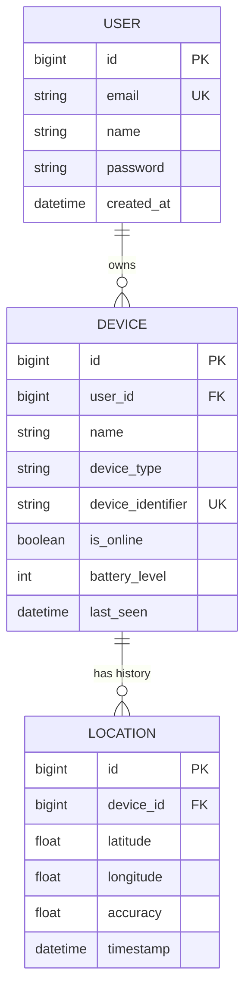

# TraceUp Find My Device - Database Schema & Architecture

## Overview
The backend uses **PostgreSQL** (`find_my_device`) as the permanent source of truth for storing users, registered devices, and historical location logs.

---

## 1. User Model (`accounts_user`)
Custom user model using email as the primary login credential (`USERNAME_FIELD = 'email'`).

| Field Name | Type | Constraints / Details |
|---|---|---|
| `id` | BigAutoField | Primary Key, Auto Increment |
| `email` | EmailField(255) | Unique, Required, Indexed |
| `name` | CharField(255) | Required |
| `password` | CharField(128) | Hashed using PBKDF2 / Argon2 (Django standard) |
| `is_active` | BooleanField | Default: `True` |
| `is_staff` | BooleanField | Default: `False` |
| `created_at` | DateTimeField | Default: `timezone.now` |

---

## 2. Device Model (`devices_device`)
Represents an Android or mobile device linked to a user.

| Field Name | Type | Constraints / Details |
|---|---|---|
| `id` | BigAutoField | Primary Key, Auto Increment |
| `user_id` | ForeignKey -> User | `on_delete=CASCADE`, `related_name='devices'` |
| `name` | CharField(255) | User friendly name (e.g. "Rajini's Pixel 8 Pro") |
| `device_type` | CharField(100) | Device category (e.g. `android`) |
| `device_identifier` | CharField(255) | Unique hardware/installation UUID |
| `is_online` | BooleanField | Default: `False` |
| `battery_level` | IntegerField | Range 0 to 100, Default: 100 |
| `last_seen` | DateTimeField | Nullable, updated on location push |
| `created_at` | DateTimeField | Auto add timestamp |
| `updated_at` | DateTimeField | Auto update timestamp |

---

## 3. Location Model (`locations_location`)
Stores historical coordinate tracking records for each device.

| Field Name | Type | Constraints / Details |
|---|---|---|
| `id` | BigAutoField | Primary Key, Auto Increment |
| `device_id` | ForeignKey -> Device | `on_delete=CASCADE`, `related_name='locations'` |
| `latitude` | FloatField | Range: `-90.0` to `90.0` |
| `longitude` | FloatField | Range: `-180.0` to `180.0` |
| `accuracy` | FloatField | GPS accuracy radius in meters |
| `timestamp` | DateTimeField | Timestamp of recorded location |

---

## Entity Relationship Diagram (ERD)

---

## 4. Redis Temporary Key-Value Storage Architecture

Redis is integrated strictly as a high-performance in-memory cache/state engine for temporary, short-lived device status and heartbeat tracking. **PostgreSQL remains the sole permanent source of truth.**

| Key Pattern | Data Structure | TTL / Scope | Description |
|---|---|---|---|
| `traceup:device:{device_id}:state` | String (JSON) | 300s (Default) | Stores transient device activity, online status, battery level, and last activity timestamp. Auto-expires when inactive. |
| `traceup_device_{device_id}` | Channel Group | Real-Time Pub/Sub | Django Channels Redis channel layer group for broadcasting real-time location updates to authorized connected WebSocket clients. |

